  

  
  
  
  
  
  

  More: <a href="https://github.com/man-Yocto/libft">libft</a> ·
  <a href="https://github.com/man-Yocto/cpp-modules-05-09">cpp-modules-05-09</a> ·
  <a href="https://github.com/man-Yocto/cpp-modules-00-04">cpp-modules-00-04</a> ·
  <a href="https://github.com/man-Yocto/pipex">pipex</a> ·
  <a href="https://github.com/man-Yocto/push_swap">push_swap</a> ·
  <a href="https://github.com/man-Yocto/so_long">so_long</a> ·
  <a href="https://github.com/man-Yocto/ft_printf">ft_printf</a> ·
  <a href="https://github.com/man-Yocto/get_next_line">get_next_line</a>

  

  
  
  
   
  
  
  

